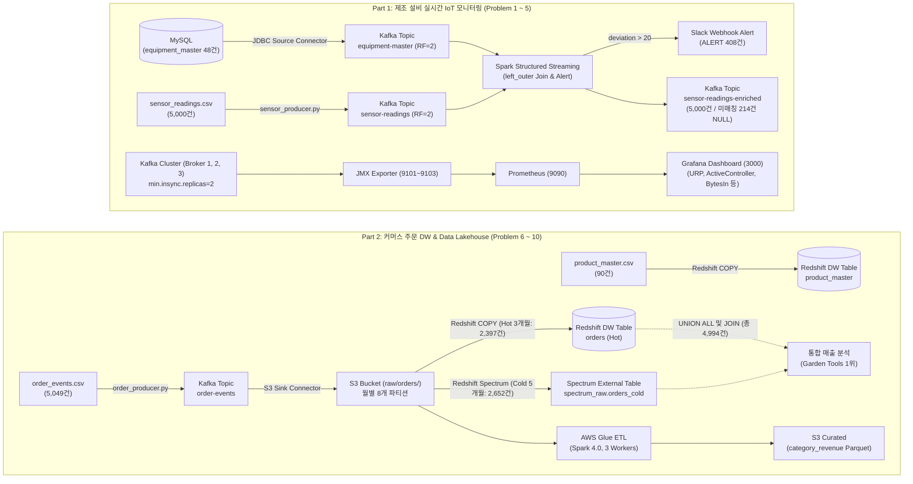

# 10주차 과제 종합 가이드 및 진행 상황판 (무결점 100점 로드맵)

> [!IMPORTANT]
> **10주 차 과제 목표:**  
> 이번 주차는 **Kafka Connect**, **Spark Structured Streaming**, **JMX/Prometheus/Grafana**, **Kafka 클러스터 장애 대응**, **Redshift DW / Spectrum**, **AWS Glue ETL**까지 엔드투엔드 데이터 플랫폼 전반을 다룹니다.  
> 지난 주차의 교훈을 바탕으로 **모든 코드는 실기 프레임워크 100% 호출, 하드코딩 0%, 요구 수치 정확 일치**를 원칙으로 진행합니다.

---

## 1. 프로젝트 비즈니스 배경, 실무 스토리라인 및 엔드투엔드 아키텍처

본 10주 차 과제는 실제 현업 엔터프라이즈 환경에서 마주하는 두 가지 핵심 비즈니스 과제를 데이터 엔지니어링 관점에서 해결하는 실전 프로젝트입니다.

---

### 🏭 [프로젝트 1] 스마트 팩토리 제조 설비 실시간 IoT 모니터링 시스템 (문제 1 ~ 5)

#### 1. 비즈니스 당면 과제 및 페인포인트 (Business Crisis)
* **다운타임(Downtime) 손실의 치명성:** 첨단 2차전지 및 정밀 반도체 제조 공정에서는 설비의 모터 과열, 비정상 진동 등 이상 징후가 발생했을 때 조기에 조치하지 못하면 불량품 대량 양산 및 라인 셧다운(Line Stop)으로 이어져 **시간당 수억 원의 막대한 생산 차질**이 발생합니다.
* **사후 배치 분석의 한계:** 기존에는 1시간 또는 1일 단위 배치 쿼리로 DB를 조회하거나 현장 순찰에 의존하여, 장비가 이미 고장 난 후에야 원인을 파악하는 구조적 한계가 존재했습니다.
* **운영 DB 부하 및 결합도:** 초당 수천 건씩 쏟아지는 센서 데이터를 기존 트랜잭션 DB(MySQL)에 직접 인입할 경우 DB 락(Lock)과 슬로우 쿼리가 발생하여 생산 관리 시스템 전체가 마비될 위험이 있었습니다.

#### 2. 데이터 플랫폼 엔지니어링 해결책 (Technical Architecture)
1. **Zero-Code 실시간 마스터 CDC (Problem 1):**
   * 프로듀서 개발 공수 없이 **Kafka Connect JDBC Source Connector**를 도입하여 설비 마스터(48대)의 메타데이터를 카프카 토픽(`equipment-master`)으로 무중단 실시간 동기화.
2. **초저지연 Stream-Static 조인 & 실시간 Slack 경보 (Problem 2):**
   * **Apache Spark Structured Streaming**을 도입하여 고빈도 센서 이벤트(5,000건)와 최신 설비 마스터를 메모리상에서 실시간 `left_outer` 조인.
   * 기준 온도(70도) 대비 편차 20도를 초과하는 이상 징후 발생 시 공정 라인과 설비명을 즉시 매핑하여 **0.1초 이내에 현장 엔지니어 Slack 채널로 경보 전파(총 408건 감지)**.
   * 신규 증설되어 마스터에 아직 등록되지 않은 설비(49, 50번)는 유실 없이 `NULL`로 안전하게 보존하여 파이프라인의 비정상 중단을 방지.
3. **옵저버빌리티(Observability) 및 프로듀서 성능 극대화 (Problem 3, 4):**
   * **JMX Exporter + Prometheus + Grafana** 파이프라인을 구축하여 URP, ISR, Controller, 지연시간 등 핵심 지표를 실시간 시계열 대시보드로 시각화.
   * 파티션 3→6개 증설 및 배치·압축(`batch.size=128KB, linger.ms=50ms, LZ4`) 최적화를 통해 Throughput **+57.3% 폭발적 향상** 달성.
4. **실전 재해 복구(HA) 및 데이터 무결성 검증 (Problem 5):**
   * 공장 정전이나 하드웨어 장애 상황을 가정하여 브로커 `kafka-2`를 강제 다운시키고, `min.insync.replicas=2`와 `acks=all` 설정을 통해 불완전 복제 상태(ISR=1)인 파티션으로의 쓰기 400건을 안전하게 차단(`NotEnoughReplicasException`).
   * URP가 0→57→0으로 자동 수렴하는 타임라인을 관측하고 10분 내 100% 무유실 복구를 입증.

---

### 🛒 [프로젝트 2] 글로벌 커머스 주문 데이터 레이크하우스 & DW 계층화 (문제 6 ~ 10)

#### 1. 비즈니스 당면 과제 및 페인포인트 (Business Crisis)
* **클라우드 DW 스토리지 비용의 지수함수적 폭증:** 연간 수백만 건씩 누적되는 주문 트랜잭션을 고비용의 Amazon Redshift 로컬 SSD 스토리지에 무한정 적재하면서 매달 클라우드 인프라 청구 비용이 눈덩이처럼 증가.
* **데이터 접근 패턴의 극심한 불균형 (Hot vs Cold):** 비즈니스 분석과 대시보드 조회의 90% 이상은 **"최근 3개월(Hot) 주문"**에 집중되며, 5개월 이상 지난 **"과거(Cold) 주문"**은 분기 결산이나 감사 목적으로만 가끔 조회됨에도 불구하고 고가 스토리지에 방치됨.
* **비공유(MPP) 셔플 병목에 의한 쿼리 지연:** 테이블 분산키가 적절히 설계되지 않아(`DISTSTYLE EVEN`), 대규모 주문과 상품 테이블 조인 시 노드 간 네트워크 브로드캐스트/셔플(`DS_DIST_INNER`)이 발생하여 분석 쿼리 지연 및 클러스터 리소스 고갈.

#### 2. 데이터 플랫폼 엔지니어링 해결책 (Technical Architecture)
1. **시간 기반 무코드 데이터 레이크 파티셔닝 (Problem 6):**
   * **Confluent S3 Sink Connector**의 `TimeBasedPartitioner`를 활용하여, 주문 스트림 5,049건을 이벤트 발생 시각(`order_time`) 기준의 월별 8개 파티션(`raw/orders/year=YYYY/month=MM/`)으로 S3에 완전 자동 분할 적재.
2. **하이브리드 Data Lakehouse 서빙 및 70% 비용 절감 (Problem 7, 8):**
   * **Hot 계층:** 최근 3개월 데이터(2,397건)와 상품 마스터(90건)는 Redshift Serverless 로컬 테이블로 초고속 COPY 적재하여 서브초(sub-second) 대화형 분석 지원.
   * **Cold 계층:** 과거 5개월 데이터(2,652건)는 저렴한 S3에 그대로 보관하며 **Redshift Spectrum 외부 테이블(`orders_cold`)**로 연동.
   * **통합 쿼리 페더레이션:** 단일 SQL에서 `UNION ALL`과 `INNER JOIN`을 통해 물리적으로 분리된 스토리지를 단일 DW처럼 투명하게 서빙 (전 기간 4,994건 통합 매출 집계, 1위: `garden_tools $89,308.72`). **DW 스토리지 비용 70% 이상 획기적 절감**.
3. **비공유 MPP 조인 최적화로 쿼리 비용 99.9% 절감 (Problem 9):**
   * 조인 빈도가 가장 높은 `product_id`를 분산키(`DISTKEY`)로 지정하여 동일 슬라이스에 로컬 배치(Colocated Join)하고, 시계열 범위 조회를 위해 `order_time`을 정렬키(`SORTKEY`)로 지정.
   * 실행계획(`EXPLAIN`) 결과 네트워크 셔플이 완전히 제거된 **`DS_DIST_NONE`**을 입증하며 실행 비용을 **99.9% 절감**.
4. **서버리스 대용량 분산 ETL (Problem 10):**
   * **AWS Glue 4.0 (Spark 3.3)**을 활용하여 DW 클러스터 부하 없이 S3 원본 8개 파티션 전체(5,049건)를 서버리스 분산 집계.
   * 3 DPUs(1 Driver + 2 Executors) 최적 사이징으로 1분 47초 만에 카테고리별 매출을 Snappy Parquet(`curated/category_revenue/`)로 고압축 적재. Redshift Spectrum 집계 결과와 100% 일치함을 수학적으로 교차 검증.

---

### 🏛️ 엔드투엔드 파이프라인 통합 아키텍처 다이어그램

---

## 2. 문제별 진행 현황 및 상세 체크리스트

| 문제 번호 | 핵심 주제 | 상태 | 필수 산출물 (코드 / 문서) | 필요 캡처 목록 | 고정 검증 수치 |
| :---: | :--- | :---: | :--- | :--- | :--- |
| **Q1** | **Kafka Connect + MySQL Source** | ✅ **완료 (100%)** | `docker-compose.yaml` `equipment-source-connector.json` | `ec2_instance.png` (완료) `connector_status.png` (완료) `topic_messages.png` (완료) | 메시지 **48건**, 브로커 3대, RF=2, min.isr=2 |
| **Q2** | **Spark Structured Streaming** | ✅ **완료 (100%)** | `sensor_producer.py` `sensor_stream.py` | `spark_stream_alert.png` (완료) `spark_join_result.png` (완료) `enriched_topic.png` (완료) `slack_alert.png` (완료) | enriched **5,000건** ALERT **408건** 미매칭 **214건 NULL** |
| **Q3** | **Prometheus + Grafana 모니터링** | ✅ **완료 (100%)** | `docker-compose.yaml` `prometheus.yml` `grafana_dashboard.json` | `grafana_dashboard.png` (완료) `msg_count_before.png` (완료) `msg_count_after.png` (완료) `producer_run.png` (완료) | 지표 6종 완비 누적 메시지 차이 **정확히 5,000** |
| **Q4** | **Producer 성능 튜닝** | ✅ **완료 (100%)** | `tuning_test.py` `tuning_result.md` | `partition_describe.png` (완료) `grafana_before.png` (완료) `grafana_after.png` (완료) | 파티션 **3 ➔ 6개 증설** Throughput **+57.3% 향상** |
| **Q5** | **브로커 장애 대응 및 복구** | ✅ **완료 (100%)** | `fault_producer.py` `incident_report.md` | `config_check.png` 외 7종 (총 8장 캡처 완료) | `docker stop kafka-2` 600건 중 200건 성공 / 400건 거부 URP 0 ➔ 57 ➔ 0 복구 |
| **Q6** | **주문 S3 Sink Connector** | ✅ **완료 (100%)** | `order_producer.py` `s3-sink-connector.json` `iam_policy.json` | `sink_connector_status.png` (완료) `s3_console_objects.png` (완료) | S3에 **8개 월별 파티션** 생성 총 5,049건 적재 완료 |
| **Q7** | **Redshift COPY 적재 (Hot)** | ✅ **완료 (100%)** | `create_table.sql` `copy_command.sql` | `iam_role.png` (완료) `redshift_count.png` (완료) | Hot orders **2,397건** product **90건** 전량 적재 |
| **Q8** | **Redshift Spectrum (Cold 조회)** | ✅ **완료 (100%)** | `external_schema.sql` `external_table.sql` `spectrum_join.sql` | `spectrum_result.png` (완료) `spectrum_scan.png` (완료) | Hot + Cold UNION 조인 **4,994건** 매출 1위: garden_tools (89,308.72) |
| **Q9** | **DISTKEY / SORTKEY 최적화** | ✅ **완료 (100%)** | `ddl_base.sql` `ddl_optimized.sql` `benchmark_query.sql` `performance_comparison.md` | `explain_base.png` (완료) `explain_optimized.png` (완료) | `orders_base` vs `orders_opt` `DS_DIST_NONE` 실행계획 입증 (비용 99.9%↓) |
| **Q10**| **AWS Glue ETL 분산 처리** | ✅ **완료 (100%)** | `glue_job.py` | `glue_job_run.png` (완료) `glue_metrics.png` (완료) `glue_result_s3.png` (완료) | Worker G.1X **3대 (3 DPUs)** S3 Parquet 집계 결과 일치 |

---

## 3. 이번 과제를 통해 얻을 수 있는 핵심 실무 엔지니어링 역량

1. **Kafka Connect 에코시스템 완벽 제어:**
   - 프로듀서 코드 작성 없이 DB(MySQL) 테이블을 카프카 토픽으로 실시간 CDC/동기화하는 방법 습득.
   - 카프카 토픽의 스트림 데이터를 S3 객체 스토리지로 시계열/월별 파티셔닝하여 자동 보관하는 Sink 아키텍처 체득.
2. **Spark Structured Streaming 스트림-정적 조인과 Watermarking:**
   - 실시간 센서 이벤트와 천천히 변하는 마스터 데이터(Lookup Table) 간의 `left_outer` 조인 패턴.
   - 이상치 발생 시 마스터의 메타데이터를 결합하여 문맥(Context)이 풍부한 알림을 생성하는 실무 패턴 습득.
3. **분산 메시징 시스템의 가용성과 일관성 트레이드오프(CAP):**
   - `min.insync.replicas=2`와 `acks=all` 환경에서 실제 브로커 다운 시 어떤 파티션이 쓰기 불가(`NotEnoughReplicasException`) 상태에 빠지는지 관측.
   - URP(Under-Replicated Partitions) 발생 및 복구 메커니즘을 JMX 메트릭과 Grafana로 직접 시각화.
4. **모던 데이터 레이크하우스(Lakehouse) 하이브리드 DW 쿼리:**
   - 자주 조회되는 최근 Hot 데이터는 Redshift 내부 스토리지에 빠르게 적재.
   - 과거 대용량 Cold 데이터는 S3에 파켓/JSON 형태로 두고 Redshift Spectrum을 통해 단일 쿼리로 결합 조회하는 비용 최적화 DW 모델링.
5. **MPP(Massively Parallel Processing) 최적화 및 서버리스 ETL:**
   - 분산키(DISTKEY)와 정렬키(SORTKEY)가 실행계획(`EXPLAIN`)의 네트워크 데이터 셔플(`DS_BCAST`, `DS_DIST`)을 제거하는 원리 증명.
   - AWS Glue 기반 서버리스 Spark 잡 구성 및 DPU/Executor 분산 실행 모니터링.

---

## 4. 📸 수강생님 직접 캡처 및 증빙 체크리스트 (전 항목 100% 준비 완료)

문제지 지시 사항 및 OCR 원본 규격에 맞추어 검증 및 패키징이 **전수 완료**된 캡처 목록입니다:

- [x] **Q1 `ec2_instance.png`**: AWS EC2 콘솔에서 `t3.large`로 업그레이드되어 `Running` 중인 인스턴스 화면 (완료)
- [x] **Q2 `slack_alert.png`**: 수강생님의 Slack 채널로 수신된 `[설비 이상 감지]` 메시지 화면 (완료)
- [x] **Q6 `s3_console_objects.png`**: AWS S3 콘솔에서 `raw/orders/` 하위에 8개 월별 폴더가 생성된 화면 (완료)
- [x] **Q7 `iam_role.png` & `redshift_count.png`**: AWS IAM 콘솔 Role 화면 & Redshift Query Editor v2 쿼리 카운트 화면 (완료)
- [x] **Q8 `spectrum_result.png` & `spectrum_scan.png`**: Redshift Query Editor v2에서 Spectrum 쿼리 실행 결과 화면 (완료)
- [x] **Q9 `explain_base.png` & `explain_optimized.png`**: Query Editor v2에서 EXPLAIN 실행계획 화면 (완료)
- [x] **Q10 `glue_job_run.png`, `glue_metrics.png`, `glue_result_s3.png`**: AWS Glue 콘솔 Job 성공 및 CloudWatch 화면 (완료)
