# 📚 9주차 데이터 엔지니어링 과제: 실무 아키텍처 및 진행 가이드 (Recap & Dashboard)

본 문서는 데엔 7기 9주차 주관식 과제인 **Kafka(AWS EC2) 실시간 스트리밍 & S3 Bronze/Silver/Gold 배치 파이프라인**을 수행하며 구축하는 데이터 아키텍처, 단계별 구현 로직, 검증 포인트 및 진행 상황을 체계적으로 추적·정리하는 마스터 대시보드 문서입니다.

---

## 🏆 100점 만점 과제 진행 현황판 (현재: 10100 / 100 (전 문항 완료))

| 번호 | 영역 | 핵심 기술 스택 | 핵심 채점 기준 및 요구사항 | 배점 | 상태 |
| :---: | :--- | :--- | :--- | :---: | :---: |
| **Q1** | Kafka 인프라 | AWS EC2, Docker Compose, Kafka 3 Broker, UI | EC2(Ubuntu, 보안그룹 5종), Kafka Broker 3대 + kafka-ui + Spark Master/Worker, 토픽 생성(`--partitions 3 --replication-factor 2`), 웹 콘솔 캡처 | 10 | ✅ 완료 (10/10) |
| **Q2** | 스트림 Producer | Python, kafka-python, JSON | `charger_sessions.csv` 175건 시간차 replay, `acks='all'`, `enable.idempotence=True`, 파티션 키=`stationName`, 메시지 수 175건 일치 | 10 | ✅ 완료 (10/10) |
| **Q3** | Consumer & Rebalance | Pure Kafka Consumer, Group, Offset | `enable_auto_commit=False` 수동 커밋, 2개 컨슈머 동시 기동 파티션 리밸런싱, `endedBy` 3종 집계(155/18/2), Kafka UI Member 2개 & Lag 캡처 | 10 | ✅ 완료 (10/10) |
| **Q4** | Spark Streaming | Spark Structured Streaming, S3 Parquet | Kafka readStream, `from_json`, 이중 foreachBatch(Bronze 원본 / Silver 정제 Parquet 적재), `hh:mm:ss` 초 변환 및 `idleSec` 계산, 콘솔 집계 출력 | 10 | ✅ 완료 (10/10) |
| **Q5** | 이상 감지 & Cloud DW | Slack Webhook, S3 Gold, AWS Athena | `idleSec > 5400`(90분 초과) 실시간 감지 18건 Slack 알림 전송, S3 Gold 구역별 집계 Parquet 적재, Athena External Table 등록 및 웹 콘솔 쿼리 | 10 | ✅ 완료 (10/10) |
| **Q6** | 배치 Producer | Python, Kafka, JSON | `india_grocery_prices.csv` 200건(10대 도시 x 10개 품목 x 2개월) `product-prices` 토픽 전송, Kafka UI 메시지 수 200건 일치 | 10 | ✅ 완료 (10/10) |
| **Q7** | Spark 배치 ETL | PySpark, S3 Parquet, Data Cleaning | Kafka 배치 읽기, Bronze 원본 적재, from_json + Double 캐스팅 + 결측치/음수 필터 Silver 적재, 12월 10대 품목 평균가 집계 검증 | 10 | ✅ 완료 (10/10) |
| **Q8** | MoM 시계열 분석 | PySpark SQL, Join, Round, Gold | 11월 vs 12월 품목별 평균가 조인, 전월대비 변동률(MoM %) 산출, Top 3 선정(감자 -24.35%, 토마토 -21.41%, 밀가루 +2.50%), Gold S3 적재 | 10 | ✅ 완료 (10/10) |
| **Q9** | DataOps 자동화 | Airflow, SparkSubmitOperator, Athena | `SparkSubmitOperator` 필수 사용(BashOperator 시 0점), Athena 테이블 자동 등록 태스크, 일 배치 스케줄(@daily), DAG 성공 및 Athena 콘솔 캡처 | 10 | ✅ 완료 (10/10) |
| **Q10** | Kafka 운영 모니터링 | Python, KafkaAdminClient, Lag CLI | `kafka_lag_monitor.py` 스크립트 작성, 파티션별 current-offset, log-end-offset, lag 표 형태 출력, 서버 생성 실측 오프셋 기반 검증 | 10 | ✅ 완료 (10/10) |
| **합계** | **10개 전 문항 무감점 100점 만점 목표** | | | **100** | **100 / 100** |

---

## 🏛️ 전체 엔드투엔드 데이터 플랫폼 마스터 아키텍처

```mermaid
flowchart TB
    subgraph S1["Part 1: 전기차 충전소 실시간 스트리밍 모니터링 파이프라인 (Q1 ~ Q5)"]
        CSV1["📁 charger_sessions.csv\n(175건 실측 세션)"] -->|"charger_producer.py\nacks='all', 멱등성\nKey=stationName"| Kafka_EV["📨 Kafka Topic: ev-charging-sessions\n(Partitions: 3, Replicas: 2)\nEC2 Docker Cluster (Broker 1, 2, 3)"]
        
        Kafka_EV -->|"Q3: 순수 Consumer 2개 병렬\nenable_auto_commit=False\n파티션 리밸런싱 관찰"| Cons_EV["👥 Consumer Group: ev-consumer-group\n수동 커밋 + Lag 모니터링\nendedBy 집계 (155 / 18 / 2)"]
        
        Kafka_EV -->|"Q4: Spark Structured Streaming\nreadStream + from_json\n이중 foreachBatch 적재"| S4_Stream["⚡ Spark Streaming Engine\n(Master + Worker)\nComplete Output Console 집계"]
        
        S4_Stream -->|"가공 없는 원본 이벤트"| S3_B1["🥉 Bronze Layer (S3)\ns3://de7-junekim-week9/bronze/ev-charging-sessions/\ndt=2017-06-06/ (Parquet)"]
        S4_Stream -->|"stationName 정제 + hh:mm:ss 초 변환\nidleSec(미방출시간) 계산"| S3_S1["🥈 Silver Layer (S3)\ns3://de7-junekim-week9/silver/ev-charging-sessions/\ndt=2017-06-06/ (Parquet)"]
        
        S3_S1 -->|"Q5: idleSec > 5400s (90분 초과)\n18건 실시간 감지"| Slack["🚨 Slack Webhook 실시간 알림\n(stationName, locationGroup, idleSec)"]
        S3_S1 -->|"설치구역별 이상 건수 집계"| S3_G1["🥇 Gold Layer (S3)\ns3://de7-junekim-week9/gold/ev_charging_agg/ (Parquet)"]
        S3_G1 -->|"CREATE EXTERNAL TABLE"| Ath_EV["🔍 AWS Athena Query Editor\n구역별 이상 건수 웹 콘솔 쿼리 검증"]
    end

    subgraph S2["Part 2: 인도 식료품 가격 배치 인텔리전스 파이프라인 (Q6 ~ Q10)"]
        CSV2["📁 india_grocery_prices.csv\n(10대 도시 x 10대 품목 x 200행)"] -->|"price_producer.py\n200행 전체 전송"| Kafka_Price["📨 Kafka Topic: product-prices\n(Partitions: 3, Replicas: 2)\nEC2 Docker Cluster"]
        
        Kafka_Price -->|"Q7: Spark 배치 읽기\nspark.read (availableNow)"| S7_Batch["⚡ Spark Batch Processor\nfrom_json + Double 캐스팅 + 필터"]
        S7_Batch -->|"원본 메시지"| S3_B2["🥉 Bronze Layer (S3)\ns3://de7-junekim-week9/bronze/product-prices/"]
        S7_Batch -->|"정제된 10대 품목 데이터"| S3_S2["🥈 Silver Layer (S3)\ns3://de7-junekim-week9/silver/product-prices/"]
        
        S3_S2 -->|"Q8: 11월 vs 12월 평균가 조인\nMoM 변동률 계산 & Top 3"| S3_G2["🥇 Gold Layer (S3)\ns3://de7-junekim-week9/gold/grocery_price_agg/\n(item_name, price_nov, price_dec, change_rate)"]
        
        S3_G2 -->|"Q9: Airflow DAG 자동화\nSparkSubmitOperator (필수)\n@daily 스케줄"| Airflow["🚀 Apache Airflow\nDAG: price_pipeline_dag\nAthena 테이블 자동 등록 & 검증"]
        Airflow -->|"웹 콘솔 조회"| Ath_Price["🔍 AWS Athena Query Editor\n10대 품목 변동률 웹 콘솔 조회"]
        
        Kafka_Price -.->|"Q10: 운영 모니터링 CLI\nKafkaAdminClient"| Lag_Mon["📊 kafka_lag_monitor.py\n파티션별 Current/End Offset & Lag 표 출력"]
    end
```



---

## 🚨 채점관 0점 게이트 및 감점 방어 프로토콜

| 구분 | 위험 요소 | 채점관 규정 | 우리의 무감점 방어 전략 |
| :---: | :--- | :--- | :--- |
| **0점 게이트 1** | **AWS 웹 콘솔 캡처 누락** | S3, Athena, EC2 확인은 반드시 **AWS 웹 콘솔 화면**이어야 함. CLI(`aws s3 ls` 등) 또는 `print()` 출력 단독 제출 시 해당 Part **0점 처리** | 모든 S3 버킷, Athena Query Editor, EC2 인스턴스 캡처는 **AWS Management Console 브라우저 전체 화면**으로 캡처 |
| **0점 게이트 2** | **Part별 핵심 실행증빙 누락** | Part 1: EC2 + Kafka UI + S3 + Athena 누락 시 Part 1 **전체 0점**<br/>Part 2: Kafka UI + S3 + Athena + Airflow DAG 누락 시 Part 2 **전체 0점** | 각 파트의 게이트 대상 4대 핵심 캡처를 최우선으로 검증 완료 후 패키징 |
| **0점 게이트 3** | **Airflow 연동 오퍼레이터 위반** | Q9 DAG에서 `BashOperator`로 Spark 실행 시 **0점 처리** | 반드시 **`SparkSubmitOperator`**를 사용하고 `application` 경로 및 파라미터 엄격 준수 |
| **0점 게이트 4** | **Mock / 에뮬레이터 사용 금지** | `LocalStack`, `kafka-mock` 등 에뮬레이터 사용 시 **0점 처리** | 실제 AWS EC2(`t3.medium`) 및 실제 S3 버킷, 실제 Athena 환경에서 100% 실기 구동 |
| **0점 게이트 5** | **AWS 키 평문 노출** | 코드 내 하드코딩된 AWS Access Key 노출 시 **0점 처리** | EC2 IAM Role 또는 환경변수 주입을 통해 평문 키 0건 보장 |
| **감점 방어** | **폴더 구조 및 파일명 위반 (-10점)** | 양식 위반 또는 지정되지 않은 임의 파일 제출 시 10점 감점 | 문제지 4페이지의 제출 트리를 1:1 바이트 단위로 대조하여 정확한 파일명만 포함 |

---

## 🎯 불변의 Ground Truth (채점관 고정 정답 수치)

문제지에서 명시한 불변의 검증 기준값으로, 우리의 코드 실행 결과와 1의 오차도 없이 일치해야 합니다:

### 1. Part 1 (전기차 충전 세션 - 175건)
- **전체 메시지 수**: 정확히 **175건** (`charger_sessions.csv`)
- **`endedBy` 3종 카운트**:
  - `Plug Out at Vehicle`: **155건**
  - `Customer`: **18건**
  - `CPS Server`: **2건**
  - *(합계: 175건)*
- **설치구역(`locationGroup`) 세션 수**:
  - HIGH: **44** / WEBSTER: **30** / MPL: **22** / CAMBRIDGE: **21** / BRYANT: **18** / HAMILTON: **16** / TED THOMPSON: **11** / RINCONADA LIB 3: **5** / RINCONADA LIB 1: **4** / RINCONADA LIB 2: **4**
- **완충 후 미방출 포트 점유 이상(`idleSec > 5400s = 90분 초과`)**:
  - **총 감지 건수**: 정확히 **18건**
  - 구역별 이상 건수: CAMBRIDGE **4** / MPL **4** / WEBSTER **4** / HIGH **2** / BRYANT **1** / HAMILTON **1** / RINCONADA LIB 1: **1** / TED THOMPSON **1** / RINCONADA LIB 2·3: **0**

### 2. Part 2 (인도 식료품 가격 - 200건)
- **전체 메시지 수**: 정확히 **200건** (10대 도시 x 10대 품목 x 2개월)
- **2016년 12월 품목별 평균 가격 (INR)**:
  - `Milk`: **41.70** / `Onions`: **14.94** / `Potatoes`: **15.14** / `Rice`: **26.77** / `Salt`: **16.00**
  - `Sugar`: **40.58** / `Tea`: **205.91** / `Tomatoes`: **15.95** / `Wheat`: **24.12** / `Wheat flour`: **26.44**
- **전월(11월) 대비 변동률(MoM %) 절대값 Top 3**:
  - **1위**: `Potatoes` **-24.35%** (20.01 ➔ 15.14)
  - **2위**: `Tomatoes` **-21.41%** (20.30 ➔ 15.95)
  - **3위**: `Wheat flour` **+2.50%** (25.79 ➔ 26.44)

---

## 📝 단계별 실행 로드맵 및 체크리스트

```text
[Step 1] 인프라 환경 기동 (Q1)
  └─ AWS EC2 인스턴스 시작 및 보안그룹(22, 9092, 8080, 4040, 8081) 점검
  └─ docker-compose.yaml 작성 (Kafka 3대 + kafka-ui + Spark Master/Worker)
  └─ 토픽 ev-charging-sessions 생성 및 Q1 웹 콘솔 & docker ps 캡처

[Step 2] 실시간 스트리밍 & Consumer (Q2 ~ Q3)
  └─ charger_producer.py 작성 (acks='all', 멱등성, Key=stationName, 175건 전송)
  └─ charger_consumer.py 작성 (수동 커밋, 2 컨슈머 리밸런싱, endedBy 155/18/2 검증)
  └─ Q2, Q3 Kafka UI 캡처 수집

[Step 3] Spark Structured Streaming & Slack & Athena (Q4 ~ Q5)
  └─ charger_stream.py 작성 (Bronze/Silver S3 적재, idleSec 계산, 구역별 집계)
  └─ idleSec > 5400s 이상 감지 18건 Slack 알림 전송 및 S3 Gold 적재
  └─ Athena 테이블 등록 및 웹 콘솔 쿼리
  └─ Q4, Q5 콘솔 & S3 & Athena 캡처 수집

[Step 4] 식료품 배치 & Spark MoM 분석 (Q6 ~ Q8)
  └─ price_producer.py 작성 (200건 전송) 및 Q6 Kafka UI 캡처
  └─ price_batch.py 작성 (Kafka 배치 읽기, Bronze/Silver 적재, 12월 평균가 검증)
  └─ 11월 vs 12월 조인 및 변동률 Top 3 산출 후 Gold S3 적재
  └─ Q7, Q8 S3 & 콘솔 캡처 수집

[Step 5] Airflow 자동화 & 운영 모니터링 (Q9 ~ Q10)
  └─ price_pipeline_dag.py 작성 (SparkSubmitOperator 필수, Athena 자동 등록)
  └─ kafka_lag_monitor.py 작성 (파티션별 Current/End Offset/Lag 표 출력)
  └─ Q9 Airflow UI & Athena 캡처, Q10 터미널 출력 캡처 수집

[Step 6] 무감점 최종 패키징 & 검증
  └─ 0점 게이트 5종 전수 재점검
  └─ .DS_Store, __pycache__, 가상환경 파일 전수 제거
  └─ 데엔7기_김준_9주차.zip 빌드 및 제출 준비 완료
```


---

## 🔍 [문항별 상세 분석 및 공식 채점 기준 예시 (Q1 ~ Q10)]

### 📌 [Q1] AWS EC2 + Kafka 3-Broker 클러스터 환경 구성 (10점)
* **요구사항**: EC2 인스턴스(t3.medium, Ubuntu 22.04), 보안그룹(22, 9092, 8080, 4040, 8081), Kafka 3대 클러스터 + kafka-ui + Spark Master/Worker, 토픽 `ev-charging-sessions` (`--partitions 3 --replication-factor 2`)
* **제출물**:
  - `part1-ev/docker-compose.yaml`
  - `part1-ev/capture/Q1/ec2_instance.png` (AWS 콘솔 Running 상태)
  - `part1-ev/capture/Q1/security_group.png` (보안그룹 인바운드 5종)
  - `part1-ev/capture/Q1/docker_ps.png` (전체 컨테이너 Running 상태)
* **공식 예시 캡처 (문제1)**: `ref_ocr/ref_q1.png`

### 📌 [Q2] 충전 세션 Producer (실측 로그 replay + Producer 심화) (10점)
* **요구사항**: `charger_sessions.csv` 175건 시간차 replay 전송, `acks='all'`, `enable.idempotence=True`, 파티션 키=`stationName`, JSON 스키마 10개 필드, `try...finally` flush/close 보장
* **제출물**:
  - `part1-ev/charger_producer.py`
  - `part1-ev/capture/Q2/kafka_ui_topic.png` (토픽 메시지 수 = **정확히 175건**)
* **공식 예시 캡처 (문제2)**: `ref_ocr/ref_q2.png`

### 📌 [Q3] Kafka Consumer 그룹 · 오프셋 · 리밸런싱 (10점)
* **요구사항**: 순수 `KafkaConsumer` 사용, `enable_auto_commit=False` 수동 커밋, endedBy별 카운트 집계 콘솔 출력, 컨슈머 2개 인스턴스 동시 실행 파티션 리밸런싱
* **제출물**:
  - `part1-ev/charger_consumer.py`
  - `part1-ev/capture/Q3/consumer_group_lag.png` (Kafka UI Consumer Groups: Member 2개, Lag 컬럼)
  - endedBy 카운트 콘솔 출력 (Plug Out 155 / Customer 18 / CPS Server 2)
* **공식 예시 캡처 (문제3)**: `ref_ocr/ref_q3.png`

### 📌 [Q4] Spark Structured Streaming - Bronze/Silver 적재 (10점)
* **요구사항**: `readStream` + `from_json`, 이중 foreachBatch Parquet 적재, Bronze(가공 없는 원본), Silver(stationName 정제 + hh:mm:ss 초 변환 + idleSec 계산), 구역별 카운트 콘솔 complete 모드 출력
* **제출물**:
  - `part1-ev/charger_stream.py`
  - `part1-ev/capture/Q4/spark_streaming.png` (콘솔 실시간 집계 출력)
  - `part1-ev/capture/Q4/s3_bronze.png` (S3 웹 콘솔, bronze 파티션 객체)
  - `part1-ev/capture/Q4/s3_silver.png` (S3 웹 콘솔, silver 파티션 객체)
* **공식 예시 캡처 (문제4)**: `ref_ocr/ref_q4.png`

### 📌 [Q5] 실시간 포트 점유 이상 감지 - Slack 알림 + Gold + Athena (10점)
* **요구사항**: Silver `idleSec > 5400s`(=90분 초과) 실시간 감지(총 18건), Slack 웹훅 알림 전송, Gold S3 설치구역별 이상 집계 Parquet 적재, Athena 테이블 등록 및 웹 콘솔 쿼리
* **제출물**:
  - `part1-ev/capture/Q5/slack_alert.png` (18건 슬랙 수신 화면)
  - `part1-ev/capture/Q5/s3_gold.png` (S3 웹 콘솔, gold 적재 객체)
  - `part1-ev/capture/Q5/athena_query_ev.png` (Athena 웹 콘솔 쿼리 결과)
* **공식 예시 캡처 (문제5)**: `ref_ocr/ref_q5.png`

### 📌 [Q6] 식료품 가격 Producer (배치 적재) (10점)
* **요구사항**: `india_grocery_prices.csv` 200행 전체 `product-prices` 토픽 전송, 스키마 7개 필드, flush/close
* **제출물**:
  - `part2-price/price_producer.py`
  - `part2-price/capture/Q6/kafka_ui_prices.png` (product-prices 토픽, 메시지 수 = **정확히 200건**)
* **공식 예시 캡처 (문제6)**: `ref_ocr/ref_q6.png`

### 📌 [Q7] Spark 배치 - Bronze/Silver 적재 (10점)
* **요구사항**: Kafka 배치 읽기, Bronze(원본 그대로 적재), Silver(from_json + Double 캐스팅 + 결측/음수 필터 Parquet 적재), 품목별·월별 집계, 12월 평균가 10품목 검증
* **제출물**:
  - `part2-price/price_batch.py`
  - `part2-price/capture/Q7/s3_bronze_price.png` (S3 웹 콘솔)
  - `part2-price/capture/Q7/s3_silver_price.png` (S3 웹 콘솔)
* **공식 예시 캡처 (문제7)**: `ref_ocr/ref_q7.png`

### 📌 [Q8] 전월대비 변동률 배치 분석 - Gold 적재 (10점)
* **요구사항**: 11월 vs 12월 평균가 조인, 변동률(MoM %) 산출, Top 3 선정(Potatoes -24.35%, Tomatoes -21.41%, Wheat flour +2.50%), Gold S3 Parquet 적재
* **제출물**:
  - `part2-price/capture/Q8/s3_gold_price.png` (S3 웹 콘솔)
  - 변동률 Top 3 콘솔 출력 캡처
* **공식 예시 캡처 (문제8)**: `ref_ocr/ref_q8.png`

### 📌 [Q9] Athena 테이블 등록 + Airflow 배치 자동화 (10점)
* **요구사항**: `price_pipeline_dag.py` 작성, 반드시 **SparkSubmitOperator** 사용 (BashOperator 대체 시 0점), Athena 테이블 생성 태스크, @daily 스케줄, 웹 콘솔 확인
* **제출물**:
  - `part2-price/dags/price_pipeline_dag.py`
  - `part2-price/capture/Q9/airflow_dag_runs.png` (DAG 성공 화면)
  - `part2-price/capture/Q9/athena_query_price.png` (Athena 웹 콘솔 쿼리 결과)
* **공식 예시 캡처 (문제9)**: `ref_ocr/ref_q9.png`

### 📌 [Q10] Kafka Consumer lag 모니터링 (운영) (10점)
* **요구사항**: `kafka_lag_monitor.py` 작성, `KafkaAdminClient` 기반 파티션별 current-offset, log-end-offset, lag 표 형태 출력, 서버 생성 실측 오프셋 기반 검증
* **제출물**:
  - `part2-price/kafka_lag_monitor.py`
  - `part2-price/capture/Q10/kafka_lag_monitor.png` (터미널 lag 조회 표 출력)
* **공식 예시 캡처 (문제10)**: `ref_ocr/ref_q10.png`
